# The Rogue Roadmap · sistema de diseño

> [Español](#español) · [English](#english)

## Español

El sistema de diseño del proyecto, nacido del brand (emblema del explorador encapuchado, sol naranja y camino) y del mod [`rogue-road`](../rogue-road/). Sirve para la interfaz de Claude, para artifacts y para cualquier otro diseño: web, presentaciones, banners.



### Qué hay aquí

| Ruta | Qué es |
|---|---|
| `tokens/tokens.json` | **Fuente de verdad.** Tokens en formato Design Tokens (DTCG): color, tema claro/oscuro, ciclo del día, tipografía, espacio, radios, sombras, movimiento |
| `tokens/tokens.css` | Variables CSS generadas (`--rr-*`), con modo claro, oscuro y fases del día |
| `components/components.css` | Componentes: botón, chip, tarjeta, campo, camino de progreso, avatar, cielo, mensajes, toast, código |
| `assets/` | El explorador (`rogue-explorer.svg`), una escena por fase (`scene-<fase>.svg`) y el glifo de la insignia del plugin |
| `showcase/index.html` | Página viva del sistema con un control de contexto que mueve al explorador y al sol |
| `claude-desktop/` | La skill y las instrucciones para aplicarlo en chats y proyectos de Claude Desktop |
| `scripts/build.mts` | Genera `tokens.css`, la escena del showcase, los SVG y las copias de la skill |

### Principios

1. **El camino es el progreso.** Todo avance (contexto, tareas, un roadmap) se dibuja como un camino que va de izquierda a derecha: lo recorrido en naranja sólido, lo pendiente punteado, un campamento ▲ al final.
2. **El día es el estado.** Alba al empezar, atardecer al acercarse al límite, anochecer cuando conviene cerrar la etapa (acampar).
3. **El explorador muestra quién tiene el turno.** Camina mientras la máquina trabaja; se detiene con el farol encendido cuando espera a la persona.
4. **Tres colores planos.** Navy, naranja y crema. Los degradados son solo para el cielo.
5. **La noche no es una inversión.** El modo oscuro es el mismo paisaje con luz de luna.

### Color

| Marca | Hex | Uso |
|---|---|---|
| Navy | `#0A1B35` | Noche, tinta, texto en claro, fondo en oscuro |
| Naranja | `#F7792C` | El sol: rellenos, botones, recorrido. Texto encima siempre navy |
| Crema | `#FCF3E1` | La capa y el camino: papel en claro, texto en oscuro |

Semánticos por modo (`--rr-…`):

| Token | Claro | Oscuro |
|---|---|---|
| `bg-page` / `bg-surface` / `bg-raised` | `#F4EAD6` / `#FCF6EA` / `#FFFCF6` | `#0A1B35` / `#0E213F` / `#152B4D` |
| `text-primary` / `text-secondary` / `text-muted` | `#0A1B35` / `#2E3D57` / `#56627A` | `#FCF3E1` / `#D9D0BF` / `#AFAA9F` |
| `accent` / `accent-text` / `on-accent` | `#F7792C` / `#A8470F` / `#0A1B35` | `#F7792C` / `#FB9B57` / `#0A1B35` |
| `border` / `border-strong` | `#DCCFB6` / `#B9AA8D` | `#23395E` / `#3A5078` |

Contraste (WCAG), calculado por `scripts/build.mts --contrast`:

| Par | Claro | Oscuro |
|---|---|---|
| texto principal sobre página | 14.4 | 15.6 |
| texto atenuado sobre página | 5.1 | 7.4 |
| texto de acento sobre página | 4.9 | 8.1 |
| navy sobre naranja | 6.3 | 6.3 |

Naranja sobre crema da 2.5:1: **nunca** como texto.

### Ciclo del día

`data-rr-phase="…"` en cualquier contenedor tiñe `--rr-phase-accent` y el cielo (`--rr-sky-top|mid|horizon`).

| Fase | Desde | Acento | Escena |
|---|---|---|---|
| `alba` | 0 % | `#E0708D` |  |
| `manana` | 15 % | `#F7792C` |  |
| `mediodia` | 35 % | `#F7792C` |  |
| `tarde` | 55 % | `#F2672E` |  |
| `atardecer` | 75 % | `#EC553F` |  |
| `anochecer` | 90 % | `#8C7BEA` |  |

### Tipografía

Outfit (SIL OFL, la fuente del brand) para títulos, interfaz y texto; JetBrains Mono para código. Escala de tercera mayor sobre 16 px: 12 · 14 · 16 · 20 · 25 · 31 · 39 · 49. Pesos 400, 500, 600 y 700. Títulos con tracking −0.02em y una regla naranja de 56 × 4 px debajo; etiquetas en mayúsculas de 12 px con tracking 0.08em.

### Espacio, forma, elevación y movimiento

- Espaciado de base 4: `--rr-space-0` a `--rr-space-10` (0 a 96 px).
- Radios: 4 · 8 · 12 · 18 · 24, píldora para botones y chips; el emblema usa 18 % del lado.
- Sombras teñidas de navy (`sm`, `md`, `lg`) y un anillo naranja (`glow`) para el foco y el farol.
- Duraciones 120 / 200 / 320 ms; un paso del explorador dura 800 ms y el farol respira cada 4 s. Todo se detiene con `prefers-reduced-motion`.

### Iconografía

Rejilla de 24 × 24, trazo 2.6 redondeado, sin relleno, como los glifos de las insignias del brand (`therogueroadmap/.github`, `brand/src/glyphs`). El glifo de `rogue-road` (sol en el horizonte y camino) está en `assets/glyph-rogue-road.svg`; conviene sumarlo al build del brand para regenerar el ícono con resvg.

### Usarlo

En HTML:

```html
<link rel="stylesheet" href="https://fonts.googleapis.com/css2?family=Outfit:wght@400;500;600;700&family=JetBrains+Mono:wght@400;500&display=swap">
<link rel="stylesheet" href="tokens/tokens.css">
<link rel="stylesheet" href="components/components.css">
<body class="rr" data-rr-phase="manana">
  <button class="rr-btn rr-btn--primary">Seguir el camino</button>
  <div class="rr-road" style="--rr-progress: 42%" data-pace="explora">
    <span class="rr-road__rogue"></span><span class="rr-road__camp"></span>
  </div>
</body>
```

Con otras herramientas (Tailwind, Figma Tokens, Style Dictionary) lee `tokens/tokens.json`, que sigue el formato DTCG.

En Claude Desktop: ver [`claude-desktop/`](claude-desktop/).

### Regenerar

Desde la raíz del repositorio, con Node 22.13 o posterior:

```bash
node --experimental-strip-types design-system/scripts/build.mts
```

```bash
design-system/scripts/package-skill.sh
```

`--check` no escribe nada y falla si algún archivo generado quedó desactualizado; la CI lo ejecuta.

## English

The project's design system, grown from the brand (the hooded explorer emblem, the orange sun and the road) and from the [`rogue-road`](../rogue-road/) mod. `tokens/tokens.json` (DTCG format) is the source of truth; `tokens/tokens.css`, the showcase's scene, the SVG assets and the Claude Desktop skill's copies are generated by `scripts/build.mts`. `components/components.css` holds buttons, chips, cards, fields, the road progress bar, avatar, sky band, messages, toast and code. `claude-desktop/` applies the system to Claude Desktop chats and projects through a skill, project instructions and a writing style. Contrast pairs, the day cycle and usage are documented in the Spanish section above.
